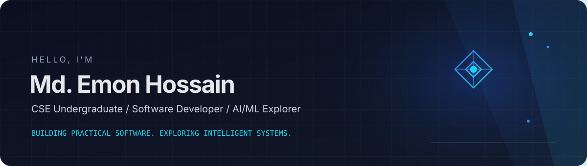

---

## About

I'm a Computer Science and Engineering undergraduate at **Daffodil International University (DIU)**, interested in building practical software and exploring how AI can help solve real-world problems.

- Build full-stack applications with an emphasis on clear workflows and maintainable code.
- Explore machine learning pipelines and applied AI through hands-on projects.
- Practice data structures, algorithms, and competitive programming.
- Learn by shipping projects, testing ideas, and documenting what I build.

> My profile reflects project-based learning and ongoing exploration—not a claim of expertise in every technology listed.

## Featured Projects

<table>
<tr>
<td width="50%" valign="top">

### [MediSeba](https://github.com/mohammademon10/MEDISEBA)

A multi-role healthcare management project with patient, doctor, and admin workflows. Includes appointment management, digital prescriptions and PDF export, with Gemini-assisted symptom and prescription explanations.

**Stack:** PHP · MySQL · JavaScript · Google Gemini API

[View repository →](https://github.com/mohammademon10/MEDISEBA)

</td>
<td width="50%" valign="top">

### [BazarCycle BD](https://github.com/mohammademon10/BazarCycle_BD_Sustainable_Project_Competition-2026)

A rule-based waste-to-resource coordination platform for Bangladeshi markets. Supports waste logging, transparent resource pathways and valuation, pickup coordination, and sustainability tracking.

**Stack:** Python · FastAPI · React · Vite · Tailwind CSS · PostgreSQL/Supabase

[View repository →](https://github.com/mohammademon10/BazarCycle_BD_Sustainable_Project_Competition-2026)

</td>
</tr>
<tr>
<td width="50%" valign="top">

### [KrishiSheba](https://github.com/mohammademon10/krishiSeba)

An agricultural equipment rental platform connecting farmers and retailers, with equipment listings, rental requests, dashboards, and role-based access for farmers, retailers, and administrators.

**Stack:** Java 17 · Spring Boot · Spring Security · Thymeleaf · PostgreSQL/H2

[View repository →](https://github.com/mohammademon10/krishiSeba)

</td>
<td width="50%" valign="top">

### [Medical Insurance Price Prediction](https://github.com/mohammademon10/Medical-insurance-price-prediction)

A machine-learning web app that estimates insurance costs from demographic and health-related inputs using a preprocessing-and-regression pipeline, served through a Gradio interface.

**Stack:** Python · Pandas · scikit-learn · XGBoost · Gradio

[Live demo ↗](https://huggingface.co/spaces/EmonHossain/Medical-insurance-price-prediction) · [Repository](https://github.com/mohammademon10/Medical-insurance-price-prediction)

</td>
</tr>
</table>

## Technology Stack

**Languages**  
     

**Frontend**  
    

**Backend & data**  
   

**AI / ML**  
    

**Tools & workflow**  
   

## GitHub Overview

These cards are generated by community-maintained services, not official GitHub analytics. Availability and displayed data may vary; if a provider is down, its image may not render.

## Competitive Programming

| Platform | Profile |
|---|---|
| LeetCode | [MD_Emon_Hossain](https://leetcode.com/u/MD_Emon_Hossain/) |
| Codeforces | [mohammademon10](https://codeforces.com/profile/mohammademon10) |
| CodeChef | [emon_hossain10](https://www.codechef.com/users/emon_hossain10) |
| HackerRank | [emonemran677](https://www.hackerrank.com/profile/emonemran677) |

## Contact

---

Learning continuously. Building thoughtfully. Solving practical problems.

